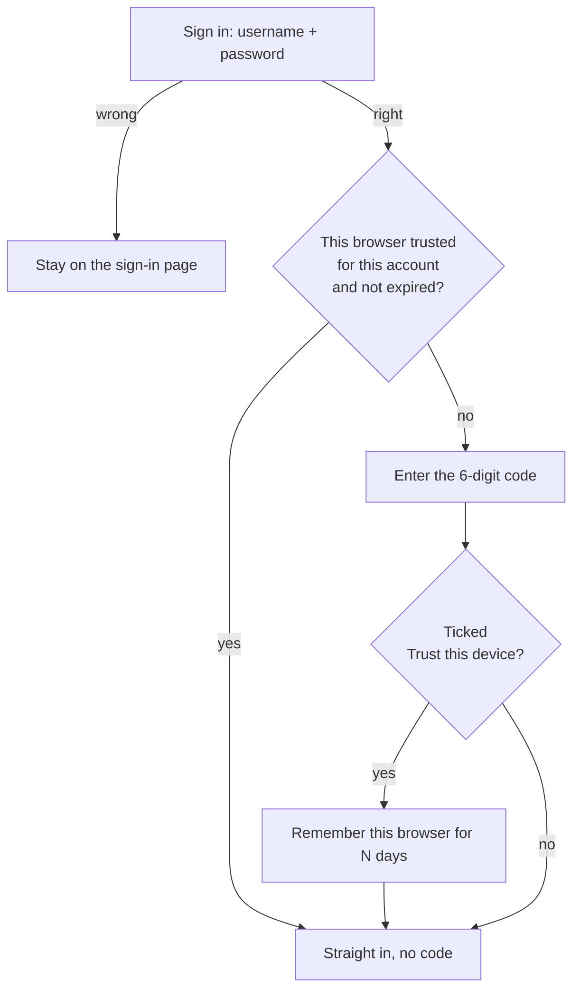
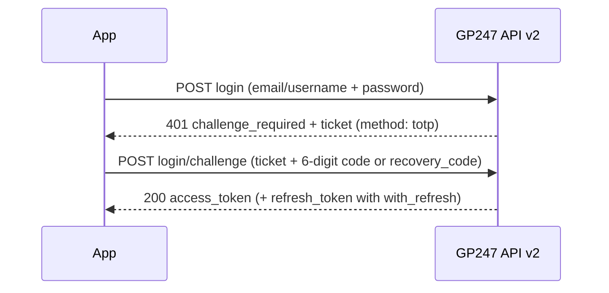

> 🌐 **Language:** [🇻🇳 Tiếng Việt](./readme_vi.md) · 🇬🇧 English (current) · [🇯🇵 日本語](./readme_ja.md)

# MFA (Multi-Factor Authentication) Plugin for GP247

## Overview

The MFA Plugin provides Two-Factor Authentication for GP247 system, enhancing user account security. The plugin supports multiple guards (customer, admin, vendor) for flexible user authentication management.

<p align="center">
  
  
  
</p>


## Features

- ✅ Two-factor authentication using TOTP (Time-based One-Time Password)
- ✅ Multiple guards support: customer, admin, vendor (with the MultiVendor plugin)
- ✅ Easy-to-scan QR codes with authenticator apps
- ✅ Recovery codes for device loss scenarios
- ✅ **Trusted devices**: no code at every sign-in on your own computer (the password is still required) — since 2.4.0
- ✅ Code guessing blocked: at most 5 wrong codes in 15 minutes, a used code cannot be reused — since 2.4.0
- ✅ MFA management from Admin panel
- ✅ Usage statistics by guard
- ✅ Optional forced MFA per guard
- ✅ Also applies to REST API v2 sign-in of customers and admins (since 2.3.0)
- ✅ Responsive and user-friendly interface
- ✅ Multi-language support (Vietnamese, English)

## System Requirements

- gp247/core >= 3.5.1 (since MFA 2.4.0)
- Laravel 13.x
- PHP >= 8.3
- Required packages:
  - pragmarx/google2fa: ^8.0 or ^9.0
  - bacon/bacon-qr-code: ^2.0 or ^3.0

## Installation

### Step 1: Install dependencies

Add the required packages to your main project's `composer.json`:

```bash
composer require pragmarx/google2fa
composer require bacon/bacon-qr-code
```

**Important**: Run this command in the root directory of your GP247 project, not inside the plugin folder.

### Step 2: Install the plugin

There are 4 methods to install the plugin:

#### Method 1: Install via Online Library

1. Navigate to "Extensions" in the admin dashboard
2. Select "Plugins"
3. Choose the "Install from Library" tab
4. Find "MFA" plugin and click "Install"
5. Click "Enable" to activate the plugin

#### Method 2: Import zip file

1. Access Admin Panel > Extensions > Plugins
2. Select the "Import file" tab
3. Choose the MFA plugin zip file
4. Complete the import process
5. Click "Enable" to activate the plugin

#### Method 3: Manual installation

In case you encounter difficulties importing the zip file (e.g. upload errors, temporary file issues, etc.):

1. Unzip and copy the source code folder to the corresponding directory:
   ```
   app/GP247/Plugins/MFA
   ```

2. Copy the `MFA/public` folder to the corresponding public path:
   ```
   public/GP247/Plugins/MFA
   ```

3. Access Admin Panel > Extensions > Plugins
4. In the default "Local storage" tab, find "MFA" and click "Install"
5. Click "Enable" to activate the plugin

#### Method 4: Install from the command line (CLI, gp247 3.x)

Since gp247 3.x you can download **MFA** from the GP247 library and install it straight from the command line, without opening the admin. **Step 1 must be done first** (`composer require pragmarx/google2fa bacon/bacon-qr-code`), otherwise the command stops because the packages are missing. Open a terminal in the website's root folder and run:

```bash
# 1) Once per website: register the (free) API License that connects the site to the GP247 library
php artisan gp247:ext-register-license

# 2) Download the plugin from the library and install it
php artisan gp247:ext-install --type=plugin --key=MFA
```

- Before step 1, make sure `APP_URL` in `.env` is the website's **real domain** (not `http://localhost`) — the license is bound to that domain.
- Once installed, the plugin is **enabled** and caches are refreshed automatically; you no longer need to click Install/Enable in the admin.
- The command checks the requirements declared in `gp247.json` (core version, composer packages, required plugins) and stops with a clear message if something is missing (e.g. `pragmarx/google2fa` or `bacon/bacon-qr-code` is not installed).
- If the folder `app/GP247/Plugins/MFA` is already on the server (copied manually or shipped with the installer), the command **installs it in place** instead of downloading it again.
- The command refuses a plugin that is already installed. To move to a newer version, run `php artisan gp247:ext-update --type=plugin --key=MFA`.
- Append `--json` to get machine-readable output (for scripts/CI).
- The post-install configuration steps below (**Step 3**) still apply.
- More: [Installing Plugins & Templates](https://github.com/gp247net/gp247-docs/blob/main/extension/install-extension.md) · [Command reference](https://github.com/gp247net/gp247-docs/blob/main/system/command-line-reference.md).

**Reference**: [Guide to Installing the Extension](https://gp247.net/en/docs/user-guide-extension/guide-to-installing-the-extension.html)

### Step 3: Configuration

After successful installation, the MFA plugin will appear in the menu:
**Admin Panel > System Configuration > Security > MFA**

#### Configuration on the admin screen

Open **Admin Panel > Security > MFA** and edit each guard on the screen. Values are stored in the database, so they **survive plugin
updates**. The file `app/GP247/Plugins/MFA/config.php` only holds defaults and is replaced on update.

**Default**: The plugin is only enabled for the **admin** guard. The **vendor** guard only applies when the site has the MultiVendor plugin.

Configuration parameters for each guard:

- **enabled**: `1` = enabled, `0` = disabled MFA for the guard
- **forced**: `1` = mandatory, `0` = optional (users can enable/disable MFA)
- **model**: User model class (in `config.php` only)
- **qr_code_size**: QR code size (50-1000px)
- **recovery_codes_count**: Number of recovery codes (1-50)
- **window**: Time window allowance (0-10, recommended 1)
- **trust_device_days**: How many days a device stays trusted (0-365, default 30; `0` = turns the "Trust this device" option off)

Example configuration:

```php
'guards' => [
    'customer' => [
        'enabled' => 0,  // Disable MFA for customer
        'forced' => 0,
        // ... other parameters
    ],
    'admin' => [
        'enabled' => 1,  // Enable MFA for admin (default)
        'forced' => 0,   // Not mandatory
        // ... other parameters
    ],
],
```

**Note**: After editing the config file, clear the cache:
```bash
php artisan config:clear
php artisan cache:clear
```

## Usage

### For End Users

#### Setup MFA

1. Go to MFA management page: `/mfa/setup/customer`
2. Scan QR code with authenticator app (Google Authenticator, Authy, Microsoft Authenticator, etc.)
3. Enter 6-digit code from app to verify
4. Save recovery codes in a secure place

#### Login with MFA

1. Login with username/password as usual
2. After successful login, system will require MFA code
3. Enter 6-digit code from authenticator app
4. Or use 8-character recovery code if device is lost

#### Manage MFA

- View MFA status: `/mfa/manage/customer`
- View recovery codes: `/mfa/recovery-codes/customer`
- Regenerate recovery codes: From MFA management page
- Disable MFA: From MFA management page (requires password confirmation)

### For Administrators

#### View Statistics

- Access Admin Panel > Extensions > MFA
- View MFA adoption rate by guard
- See total users and enabled users

#### Configure Guards

- Enable/disable MFA for each guard
- Force users to enable MFA
- Adjust technical parameters

#### Reset User MFA

- From MFA management page, admins can reset MFA for any user
- User will need to setup MFA again from scratch

## MFA Flow Diagrams

### 1. MFA Setup Flow (First Time)

```
┌─────────────────────────────────────────────────────────────┐
│                    User Login Success                        │
└────────────────────────┬────────────────────────────────────┘
                         │
                         ▼
                ┌────────────────────┐
                │  MFA Enabled for   │
                │  this guard?       │
                └────────┬───────────┘
                         │
        ┌────────────────┴────────────────┐
        │ No                               │ Yes
        ▼                                  ▼
┌───────────────┐              ┌────────────────────┐
│  Allow Access │              │ User enrolled MFA? │
└───────────────┘              └─────────┬──────────┘
                                         │
                        ┌────────────────┴────────────────┐
                        │ No                               │ Yes
                        ▼                                  ▼
              ┌──────────────────┐              ┌──────────────────┐
              │  MFA Forced?     │              │ Session verified?│
              └────────┬─────────┘              └────────┬─────────┘
                       │                                 │
         ┌─────────────┴──────────┐           ┌─────────┴─────────┐
         │ No          │ Yes      │           │ No     │ Yes      │
         ▼             ▼          │           ▼        ▼          │
    Allow Access   Redirect      │      Redirect  Allow Access   │
                   to Setup      │      to Verify                │
                       │          │           │                   │
                       ▼          │           ▼                   │
              ┌─────────────┐    │   ┌─────────────────┐        │
              │ Show QR Code│    │   │ Enter 6-digit   │        │
              │ & Secret    │    │   │ code or         │        │
              └──────┬──────┘    │   │ recovery code   │        │
                     │           │   └────────┬────────┘        │
                     ▼           │            │                  │
              ┌─────────────┐    │            ▼                  │
              │ Verify Code │    │   ┌─────────────────┐        │
              └──────┬──────┘    │   │  Code Valid?    │        │
                     │           │   └────────┬────────┘        │
                     ▼           │            │                  │
            ┌─────────────────┐ │   ┌────────┴────────┐        │
            │ Generate        │ │   │ No    │ Yes     │        │
            │ Recovery Codes  │ │   ▼       ▼         │        │
            └────────┬────────┘ │  Error  Set         │        │
                     │          │         Session     │        │
                     ▼          │         Verified    │        │
            ┌─────────────────┐ │            │        │        │
            │ Show & Save     │ │            ▼        │        │
            │ Recovery Codes  │ │    ┌──────────────┐ │        │
            └────────┬────────┘ │    │Allow Access  │ │        │
                     │          │    └──────────────┘ │        │
                     ▼          │                      │        │
            ┌─────────────────┐ │                      │        │
            │ MFA Activated   │ │                      │        │
            └────────┬────────┘ │                      │        │
                     │          │                      │        │
                     └──────────┴──────────────────────┘        │
                                │                               │
                                └───────────────────────────────┘
```

### 2. Login Flow with MFA (Already Setup)

```
┌─────────────────────┐
│ User Login          │
│ (Email + Password)  │
└──────────┬──────────┘
           │
           ▼
┌──────────────────────┐
│ Credentials Valid?   │
└──────────┬───────────┘
           │
    ┌──────┴──────┐
    │ No   │ Yes  │
    ▼      ▼      │
  Error  Check    │
         MFA      │
           │      │
           ▼      │
┌─────────────────────┐
│ User enrolled MFA?  │
└──────────┬──────────┘
           │
    ┌──────┴──────┐
    │ No   │ Yes  │
    ▼      ▼      │
  Allow  Redirect │
  Access to MFA   │
         Verify   │
           │      │
           ▼      │
┌────────────────────────────┐
│ MFA Verification Page      │
│                            │
│ [Enter 6-digit code]       │
│ or                         │
│ [Use recovery code]        │
└──────────┬─────────────────┘
           │
           ▼
┌──────────────────────┐
│ Verify Code          │
│ (TOTP or Recovery)   │
└──────────┬───────────┘
           │
    ┌──────┴──────────┐
    │ Valid │ Invalid │
    ▼       ▼         │
┌─────────────┐  ┌─────────┐
│ Set Session │  │ Show    │
│ Verified    │  │ Error   │
└──────┬──────┘  └────┬────┘
       │              │
       ▼              ▼
┌──────────────┐  ┌──────────┐
│ Allow Access │  │ Try Again│
└──────────────┘  └──────────┘
```

### 3. Recovery Code Flow

```
┌──────────────────────┐
│ User lost device     │
└──────────┬───────────┘
           │
           ▼
┌──────────────────────┐
│ Login Page           │
│ Enter credentials    │
└──────────┬───────────┘
           │
           ▼
┌──────────────────────────┐
│ MFA Verification Page    │
│                          │
│ Click "Use recovery code"│
└──────────┬───────────────┘
           │
           ▼
┌──────────────────────────┐
│ Enter 8-char recovery    │
│ code (e.g. ABCD1234)     │
└──────────┬───────────────┘
           │
           ▼
┌──────────────────────┐
│ Check recovery code  │
│ in database          │
└──────────┬───────────┘
           │
    ┌──────┴───────┐
    │ Valid│Invalid│
    ▼      ▼       │
┌────────────┐ ┌────────┐
│ Mark code  │ │ Error  │
│ as used    │ └────────┘
└─────┬──────┘     │
      │            │
      ▼            │
┌────────────┐     │
│ Login OK   │     │
└─────┬──────┘     │
      │            │
      ▼            │
┌──────────────────┐
│ Redirect to      │
│ MFA Setup        │
│ (Setup new device)│
└──────────────────┘
```

### 4. Middleware Flow

```
┌──────────────────────────┐
│ Request to protected     │
│ route with mfa.verify    │
└───────────┬──────────────┘
            │
            ▼
┌───────────────────────────┐
│ Middleware: Check Auth    │
└───────────┬───────────────┘
            │
     ┌──────┴──────┐
     │ Not  │ Auth │
     │ Auth │      │
     ▼      ▼      │
   Redirect Check  │
   to Login MFA    │
            │      │
            ▼      │
┌─────────────────────────┐
│ MFA enabled for guard?  │
└───────────┬─────────────┘
            │
     ┌──────┴──────┐
     │ No   │ Yes  │
     ▼      ▼      │
   Allow  Check    │
   Access Session  │
            │      │
            ▼      │
┌──────────────────────────┐
│ Session verified?        │
└───────────┬──────────────┘
            │
     ┌──────┴──────┐
     │ Yes  │ No   │
     ▼      ▼      │
   Allow  Check    │
   Access User     │
          MFA      │
            │      │
            ▼      │
┌──────────────────────────┐
│ User enrolled MFA?       │
└───────────┬──────────────┘
            │
     ┌──────┴──────┐
     │ No   │ Yes  │
     ▼      ▼      │
   Check  Redirect │
   Forced to MFA   │
   MFA    Verify   │
     │             │
     ▼             │
┌──────────────┐   │
│ MFA Forced?  │   │
└──────┬───────┘   │
       │           │
  ┌────┴────┐      │
  │No  │Yes │      │
  ▼    ▼    │      │
Allow Redirect     │
Access to Setup    │
       │           │
       └───────────┘
```

## Trusted devices

> ℹ️ **Available since:** MFA 2.4.0

When typing the 6-digit code, the user can tick **"Trust this device for N days"**. For those N days, signing in again on **that same
browser** only needs username + password — no authenticator app. A trusted device **never** replaces the password.



- Applies only to **the same account and the same account type** (customer / admin / vendor) that trusted it. Other accounts on the same computer still need the code.
- Not ticked by default. **Do not tick it on a shared or public computer.**
- The **recovery code** form does not offer this option.
- Users see and remove trusted devices one by one (or all at once) on the **MFA manage page** (`/mfa/manage/<guard>`).
- Every trusted device of an account is **removed automatically** when the password changes (any way), MFA is turned off, an
  administrator resets MFA, or the user signs in with a recovery code. Signing out does **not** remove trusted devices.
- The site owner sets the number of days per guard in **Admin Panel > Security > MFA** ("Trust device (days)"). `0` turns it off, and
  every device trusted for that guard stops working at once.
- Does not apply to REST API v2 sign-in (apps use refresh tokens).

**Cookie security**: the trust lives in an encrypted, `HttpOnly` cookie that follows the site's session cookie settings
(`SESSION_DOMAIN`, `SESSION_SECURE_COOKIE`, `SESSION_SAME_SITE`). HTTPS sites should set `SESSION_SECURE_COOKIE=true`. The database
only stores a hash of the trust token.

## Code entry limit

> ℹ️ **Available since:** MFA 2.4.0

The website code screen allows at most **5 wrong codes in 15 minutes** per account (6-digit codes and recovery codes count together).
Past the limit it stops checking codes (even the right one) and says how many minutes to wait. A 6-digit code that was accepted — on the
website or through the API — cannot be used again within its time window. The counter uses Laravel's default cache and works on shared hosting.

## MFA for apps using the REST API (v2)

> ℹ️ **Available since:** MFA 2.3.0 · needs gp247/core 3.5.1 (gp247/shop 3.4.0 for the customer API)

While the plugin is on, users who **turned MFA on** (with the `customer` or `admin` guard enabled) must also enter their code when
they sign in through REST API v2 — mobile and admin apps are no longer a way around MFA. The plugin registers itself with core;
nothing else to configure.



| Field sent to `login/challenge` | Meaning |
| --- | --- |
| `ticket` | The ticket from the `login` step (single use, expires after 5 minutes) |
| `code` | The 6-digit code from the authenticator app |
| `recovery_code` | Instead of `code` when the device is lost: one 8-character recovery code (used up once accepted) |

- A 6-digit code accepted through the API (or on the website) **cannot be used again** within its time window.
- A guard that **forces MFA**, for an account that has **not set it up yet**: the API answers `challenge_required` with
  `method: "setup_required"` and cannot be completed — the user turns MFA on on the website first, then signs in to the app as above.
- Accounts without MFA, or a disabled guard: API sign-in works as usual.
- API v1 has no code step: an account with MFA on gets `401 challenge_required` on v1 — use v2.

API side: [GP247 API introduction — section 10.4](https://github.com/gp247net/gp247-docs/blob/main/api/api-introduction.md).

## Code Integration

### Middleware

Use `mfa.verify` middleware to protect routes:

```php
// In routes/web.php
Route::group(['middleware' => ['auth:customer', 'mfa.verify:customer']], function () {
    Route::get('/dashboard', 'DashboardController@index');
    Route::get('/profile', 'ProfileController@index');
});

// For admin
Route::group(['middleware' => ['auth:admin', 'mfa.verify:admin']], function () {
    Route::get('/admin/dashboard', 'AdminController@index');
});
```

### Helper Functions

```php
// Check if MFA is enabled for guard (effective config: defaults + values saved on the admin screen)
if (mfa_get_guard_config('customer')['enabled'] ?? false) {
    // MFA is enabled
}

// Check if user has enrolled MFA
if (mfa_is_user_enrolled($user, 'customer')) {
    // User has enrolled MFA
}

// Check if the signed-in account of a guard passed MFA in this session (since 2.4.0: per guard + account)
if (mfa_is_verified('customer', $user)) {
    // Session is verified for this customer
}

// Mark that the account passed MFA in this session (for that guard)
mfa_set_verified('customer', $user);

// Clear the mark of one guard (no argument = every guard)
mfa_clear_verified('customer');
```

## Directory Structure

```
app/GP247/Plugins/MFA/
├── Admin/Livewire/
│   ├── MfaDashboard.php             # Statistics + guard settings screen
│   └── MfaUsers.php                 # User list / MFA reset screen
├── Api/
│   └── MfaLoginChallenge.php        # Code step for REST API v2
├── Controllers/
│   └── MFAController.php            # Main MFA controller
├── Helpers/
│   └── TwoFactorHelper.php          # Google 2FA helper
├── Lang/
│   ├── en/ · vi/ · ja/
│   │   └── lang.php                 # Translations
├── Middleware/
│   └── TwoFactorAuthentication.php # MFA verification middleware
├── Models/
│   ├── ExtensionModel.php           # Install/uninstall model
│   ├── TrustedDevice.php            # Trusted devices
│   └── TwoFactorAuth.php            # MFA storage model
├── Services/
│   └── TrustedDeviceService.php     # Trusted-device cookie + check
├── Views/
│   ├── Admin/                       # Admin views (Livewire)
│   └── Frontend/
│       ├── setup.blade.php          # MFA setup view
│       ├── verify.blade.php         # MFA verification view
│       ├── recovery_codes.blade.php # Recovery codes view
│       └── manage.blade.php         # MFA management view
├── AppConfig.php                     # Plugin configuration
├── config.php                        # Config file
├── function.php                      # Helper functions
├── gp247.json                        # Plugin metadata
├── Provider.php                      # Service provider
├── Route.php                         # Routes
└── readme.md                         # This documentation
```

## Security

### Encryption

- Secret keys are encrypted in database using Laravel Encryption
- Recovery codes are encrypted in database
- All sensitive data is protected

### Best Practices

1. **Force MFA for Admins**: Enable "Forced" for admin guard
2. **User Education**: Guide users to store recovery codes safely
3. **Regular Monitoring**: Track MFA adoption rates
4. **Backups**: Ensure database is regularly backed up
5. **HTTPS**: Require HTTPS for all MFA pages

## Supported Authenticator Apps

The plugin supports all TOTP authenticator apps:

- Google Authenticator (iOS, Android)
- Microsoft Authenticator (iOS, Android)
- Authy (iOS, Android, Desktop)
- 1Password (iOS, Android, Desktop)
- LastPass Authenticator
- Duo Mobile
- FreeOTP
- And many other TOTP apps

## Troubleshooting

### User Lost Authenticator Device

1. User uses recovery code to login
2. After login, setup MFA again with new device
3. Save new recovery codes

### Verification Code Not Working

1. Check if device time is accurate
2. Increase "Window" value in configuration (recommended 1-2)
3. Ensure correct QR code was scanned

### Admin Wants to Reset User MFA

1. Access Admin Panel > Extensions > MFA
2. Find user in list
3. Click "Reset MFA"
4. User will need to setup MFA again

## Support

- Website: https://GP247.net
- Email: support@gp247.net
- Documentation: https://gp247.net/en/product/plugin-mfa.html

## License

MIT License

## Author

GP247 Team

## Changelog

### Version 2.4.0
- **Trusted devices**: tick "Trust this device" when entering the code so that browser only needs the password next time (default 30
  days, 0–365 per guard). Removed automatically on a password change, MFA off, an admin reset or a recovery-code sign-in; users remove them on the MFA manage page
- Security hardening: the "code entered" state of a session is bound to the right account; the website code screen allows 5 wrong codes
  per 15 minutes and does not accept a used code again. Updating is recommended
- The `vendor` guard uses the MultiVendor plugin's model; the sample `pmo_partner` guard and the unused `session_lifetime` key are removed
- Requires gp247/core 3.5.1 or later

**What to do when updating**
- Back up the database (table `two_factor_auth`), then update the plugin and apply the data update (`php artisan gp247:update`, or the
  "Apply" button on the Extension screen) to create the trusted-device table.
- Signed-in users with MFA on are asked for their code **once** after the update — this is expected.
- HTTPS sites should set `SESSION_SECURE_COOKIE=true`.

### Version 2.3.0
- MFA for REST API v2 sign-in (customer + admin) through the `login/challenge` step of gp247/core: TOTP or recovery code, code replay blocked, a forcing guard blocks the API until MFA is set up

### Version 1.0
- Initial release
- Support for Customer, Admin, Vendor, PMO guards
- TOTP authentication with Google Authenticator
- Recovery codes system
- Admin management panel
- Multi-language support (Vietnamese, English)

