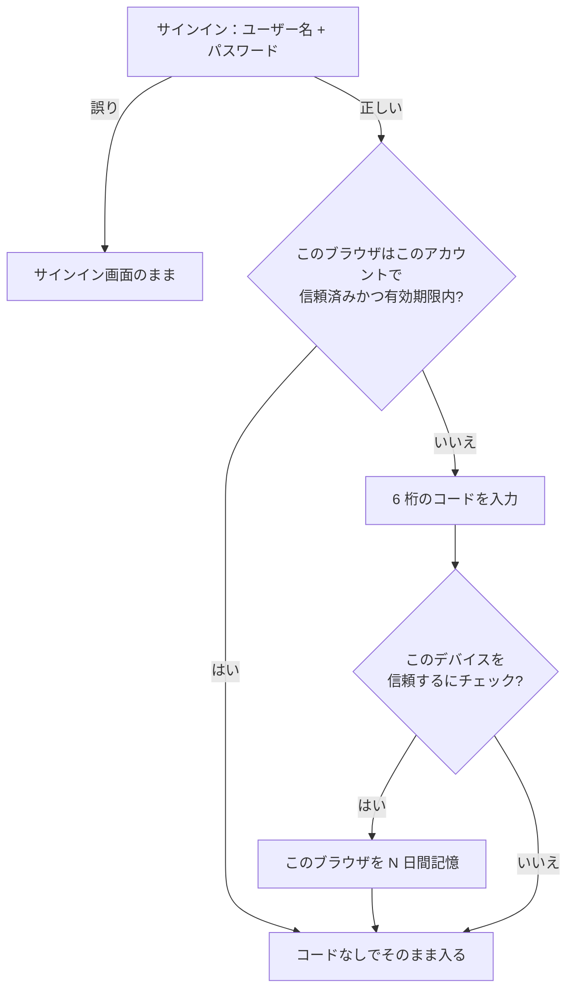
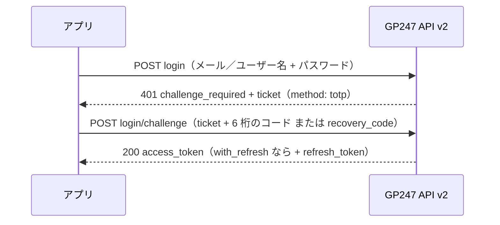

> 🌐 **言語:** [🇻🇳 Tiếng Việt](./readme_vi.md) · [🇬🇧 English](./readme.md) · 🇯🇵 日本語（現在）

# GP247 向け MFA（Multi-Factor Authentication）プラグイン

## 概要

MFA プラグインは、GP247 システムに二要素認証（Two-Factor Authentication）を提供し、ユーザーアカウントのセキュリティを強化します。複数の guard（customer、admin、vendor）に対応しており、ユーザー認証を柔軟に管理できます。

## 画面イメージ

<p align="center">
  
  
  
</p>


## 機能

- ✅ TOTP（Time-based One-Time Password）を使った二要素認証
- ✅ 複数の guard に対応：customer、admin、vendor（MultiVendor プラグイン導入時）
- ✅ 認証アプリで簡単に読み取れる QR コード
- ✅ 端末を紛失したときのためのリカバリーコード（Recovery Codes）
- ✅ **信頼済みデバイス**：自分のパソコンではサインインのたびにコードを入力する必要がありません（パスワードは常に必要）— 2.4.0 から
- ✅ コードの総当たりを防止：15 分間に最大 5 回まで、使用済みのコードは再利用不可 — 2.4.0 から
- ✅ 管理画面（Admin panel）から MFA を管理
- ✅ guard ごとの MFA 利用率の統計
- ✅ guard ごとに MFA を必須化可能
- ✅ 顧客と管理者の REST API v2 サインインにも適用（2.3.0 から）
- ✅ 使いやすくレスポンシブな画面
- ✅ 多言語対応（ベトナム語、英語）

## システム要件

- gp247/core >= 3.5.1（MFA 2.4.0 から）
- Laravel 13.x
- PHP >= 8.3
- パッケージ：
  - pragmarx/google2fa: ^8.0 または ^9.0
  - bacon/bacon-qr-code: ^2.0 または ^3.0

## インストール

### ステップ 1：依存パッケージのインストール

プロジェクトの `composer.json` にパッケージを追加します：

```bash
composer require pragmarx/google2fa
composer require bacon/bacon-qr-code
```

**注意**：このコマンドはプラグインのフォルダー内ではなく、GP247 プロジェクトのルートフォルダーで実行してください。

### ステップ 2：プラグインのインストール

プラグインのインストール方法は 4 つあります：

#### 方法 1：オンラインライブラリからインストール

1. 管理ダッシュボードの「Extensions」にアクセスします
2. 「Plugins」を選択します
3. 「Install from Library」タブを選択します
4. 「MFA」プラグインを検索して「Install」をクリックします
5. 「Enable」をクリックしてプラグインを有効化します

#### 方法 2：zip ファイルをインポート

1. Admin Panel > Extensions > Plugins にアクセスします
2. 「Import file」タブを選択します
3. MFA プラグインの zip ファイルを選択します
4. インポート処理を完了します
5. 「Enable」をクリックしてプラグインを有効化します

#### 方法 3：手動インストール

zip ファイルのインポートで問題が発生した場合（アップロードエラー、一時ファイルの問題など）：

1. 解凍して、ソースコードのフォルダーを対応するフォルダーにコピーします：
   ```
   app/GP247/Plugins/MFA
   ```

2. `MFA/public` フォルダーを対応する public パスにコピーします：
   ```
   public/GP247/Plugins/MFA
   ```

3. Admin Panel > Extensions > Plugins にアクセスします
4. デフォルトの「Local storage」タブで「MFA」を探し、「Install」をクリックします
5. 「Enable」をクリックしてプラグインを有効化します

#### 方法 4：コマンドラインでのインストール（CLI、gp247 3.x）

gp247 3.x からは、管理画面を開かずに、GP247 ライブラリから **MFA** をダウンロードしてコマンドラインですぐにインストールできます。**必ず先にステップ 1 を実行してください**（`composer require pragmarx/google2fa bacon/bacon-qr-code`）。実行していないと、パッケージ不足でコマンドが停止します。サイトのルートフォルダーでターミナルを開き、次を実行します：

```bash
# 1) ウェブサイトごとに 1 回だけ：GP247 ライブラリに接続するための API License（無料）を登録
php artisan gp247:ext-register-license

# 2) ライブラリからプラグインをダウンロードしてインストール
php artisan gp247:ext-install --type=plugin --key=MFA
```

- 手順 1 の前に、`.env` の `APP_URL` がサイトの**実際のドメイン**になっていることを確認してください（`http://localhost` のままにしないでください）。ライセンスはこのドメインに紐づけられます。
- インストールが完了すると、プラグインは**有効化済み**の状態になり、キャッシュも自動で更新されます。管理画面で Install／Enable を押す必要はありません。
- コマンドは `gp247.json` で宣言された条件（コアのバージョン、composer パッケージ、依存プラグイン）を自動でチェックします。不足があればコマンドは停止し、何が足りないかを明示します（例：`pragmarx/google2fa` または `bacon/bacon-qr-code` が未インストール）。
- `app/GP247/Plugins/MFA` フォルダーがすでにサーバー上にある場合（手動でコピーした、またはインストールパッケージに同梱されていた場合）、コマンドは再ダウンロードせず**その場でインストール**します。
- プラグインがすでにインストール済みの場合、コマンドは実行を拒否します。新しいバージョンに更新するには `php artisan gp247:ext-update --type=plugin --key=MFA` を実行します。
- コマンドの末尾に `--json` を付けると、機械可読な形式で結果を受け取れます（スクリプト／CI 用）。
- 下記のインストール後の設定手順（**ステップ 3**）はそのまま有効です。
- 詳細：[プラグイン＆テンプレートのインストールガイド](https://github.com/gp247net/gp247-docs/blob/main/extension/install-extension.md) · [コマンドリファレンス](https://github.com/gp247net/gp247-docs/blob/main/system/command-line-reference.md)。

**参考**：[拡張機能のインストールガイド](https://gp247.net/en/docs/user-guide-extension/guide-to-installing-the-extension.html)

### ステップ 3：設定

インストールが完了すると、MFA プラグインは次のメニューに表示されます：
**Admin Panel > システム設定 > セキュリティ > MFA**

#### 管理画面での設定

**Admin Panel > セキュリティ > MFA** を開き、guard ごとに画面上で設定します。値はデータベースに保存されるため、**プラグインを
更新しても失われません**。`app/GP247/Plugins/MFA/config.php` はデフォルト値だけを持ち、更新時に置き換えられます。

**デフォルト**：プラグインは **admin** guard に対してのみ有効化されています。**vendor** guard は MultiVendor プラグインを導入したサイトでのみ機能します。

各 guard の設定パラメーター：

- **enabled**：`1` = 有効、`0` = その guard の MFA を無効
- **forced**：`1` = 必須、`0` = 任意（ユーザーが MFA を有効／無効にできます）
- **model**：ユーザーの Model クラス（`config.php` のみ）
- **qr_code_size**：QR コードのサイズ（50～1000px）
- **recovery_codes_count**：リカバリーコードの数（1～50）
- **window**：許容する時間ウィンドウ（0～10、推奨は 1）
- **trust_device_days**：デバイスを信頼する日数（0～365、デフォルト 30。`0` で「このデバイスを信頼する」を無効化）

設定例：

```php
'guards' => [
    'customer' => [
        'enabled' => 0,  // customer の MFA を無効化
        'forced' => 0,
        // ... その他のパラメーター
    ],
    'admin' => [
        'enabled' => 1,  // admin の MFA を有効化（既定）
        'forced' => 0,   // 必須にしない
        // ... その他のパラメーター
    ],
],
```

**注意**：config ファイルを編集した後は、キャッシュをクリアする必要があります：
```bash
php artisan config:clear
php artisan cache:clear
```

## 使い方

### エンドユーザー向け

#### MFA の設定

1. MFA 管理ページにアクセスします：`/mfa/setup/customer`
2. 認証アプリ（Google Authenticator、Authy、Microsoft Authenticator など）で QR コードを読み取ります
3. アプリに表示される 6 桁のコードを入力して確認します
4. リカバリーコードを安全な場所に保管します

#### MFA を使ったログイン

1. 通常どおりユーザー名／パスワードでログインします
2. ログインに成功すると、システムが MFA コードを要求します
3. 認証アプリに表示される 6 桁のコードを入力します
4. 端末を紛失した場合は、8 文字のリカバリーコードを使用します

#### MFA の管理

- MFA の状態を確認：`/mfa/manage/customer`
- リカバリーコードを確認：`/mfa/recovery-codes/customer`
- リカバリーコードの再生成：MFA 管理ページから
- MFA を無効化：MFA 管理ページから（パスワードの確認が必要）

### 管理者向け

#### 統計の確認

- Admin Panel > Extensions > MFA にアクセスします
- guard ごとに MFA を有効にしたユーザーの割合を確認します
- ユーザーの総数と MFA を有効にしたユーザー数を確認します

#### guard の設定

- guard ごとに MFA を有効／無効にします
- ユーザーに MFA の有効化を必須にします
- 技術的なパラメーターを調整します

#### ユーザーの MFA リセット

- MFA 管理ページから、管理者は任意のユーザーの MFA をリセットできます
- ユーザーは MFA を最初から設定し直す必要があります

## MFA の処理フロー

### 1. MFA 設定フロー（初回）

```
┌─────────────────────────────────────────────────────────────┐
│                    User Login Success                        │
└────────────────────────┬────────────────────────────────────┘
                         │
                         ▼
                ┌────────────────────┐
                │ guard で MFA が    │
                │ 有効？             │
                └────────┬───────────┘
                         │
        ┌────────────────┴────────────────┐
        │ No                               │ Yes
        ▼                                  ▼
┌───────────────┐              ┌────────────────────┐
│  Allow Access │              │ MFA 登録済み？     │
└───────────────┘              └─────────┬──────────┘
                                         │
                        ┌────────────────┴────────────────┐
                        │ No                               │ Yes
                        ▼                                  ▼
              ┌──────────────────┐              ┌──────────────────┐
              │  MFA Forced?     │              │ Session verified?│
              └────────┬─────────┘              └────────┬─────────┘
                       │                                 │
         ┌─────────────┴──────────┐           ┌─────────┴─────────┐
         │ No          │ Yes      │           │ No     │ Yes      │
         ▼             ▼          │           ▼        ▼          │
    Allow Access   Redirect      │      Redirect  Allow Access   │
                   to Setup      │      to Verify                │
                       │          │           │                   │
                       ▼          │           ▼                   │
              ┌─────────────┐    │   ┌─────────────────┐        │
              │ Show QR Code│    │   │ Enter 6-digit   │        │
              │ & Secret    │    │   │ code or         │        │
              └──────┬──────┘    │   │ recovery code   │        │
                     │           │   └────────┬────────┘        │
                     ▼           │            │                  │
              ┌─────────────┐    │            ▼                  │
              │ Verify Code │    │   ┌─────────────────┐        │
              └──────┬──────┘    │   │  Code Valid?    │        │
                     │           │   └────────┬────────┘        │
                     ▼           │            │                  │
            ┌─────────────────┐ │   ┌────────┴────────┐        │
            │ Generate        │ │   │ No    │ Yes     │        │
            │ Recovery Codes  │ │   ▼       ▼         │        │
            └────────┬────────┘ │  Error  Set         │        │
                     │          │         Session     │        │
                     ▼          │         Verified    │        │
            ┌─────────────────┐ │            │        │        │
            │ Show & Save     │ │            ▼        │        │
            │ Recovery Codes  │ │    ┌──────────────┐ │        │
            └────────┬────────┘ │    │Allow Access  │ │        │
                     │          │    └──────────────┘ │        │
                     ▼          │                      │        │
            ┌─────────────────┐ │                      │        │
            │ MFA Activated   │ │                      │        │
            └────────┬────────┘ │                      │        │
                     │          │                      │        │
                     └──────────┴──────────────────────┘        │
                                │                               │
                                └───────────────────────────────┘
```

### 2. MFA を使ったログインフロー（設定済み）

```
┌─────────────────────┐
│ User Login          │
│ (Email + Password)  │
└──────────┬──────────┘
           │
           ▼
┌──────────────────────┐
│ Credentials Valid?   │
└──────────┬───────────┘
           │
    ┌──────┴──────┐
    │ No   │ Yes  │
    ▼      ▼      │
  Error  Check    │
         MFA      │
           │      │
           ▼      │
┌─────────────────────┐
│ User enrolled MFA?  │
└──────────┬──────────┘
           │
    ┌──────┴──────┐
    │ No   │ Yes  │
    ▼      ▼      │
  Allow  Redirect │
  Access to MFA   │
         Verify   │
           │      │
           ▼      │
┌────────────────────────────┐
│ MFA Verification Page      │
│                            │
│ [Enter 6-digit code]       │
│ or                         │
│ [Use recovery code]        │
└──────────┬─────────────────┘
           │
           ▼
┌──────────────────────┐
│ Verify Code          │
│ (TOTP or Recovery)   │
└──────────┬───────────┘
           │
    ┌──────┴──────────┐
    │ Valid │ Invalid │
    ▼       ▼         │
┌─────────────┐  ┌─────────┐
│ Set Session │  │ Show    │
│ Verified    │  │ Error   │
└──────┬──────┘  └────┬────┘
       │              │
       ▼              ▼
┌──────────────┐  ┌──────────┐
│ Allow Access │  │ Try Again│
└──────────────┘  └──────────┘
```

### 3. リカバリーコードの使用フロー

```
┌──────────────────────┐
│ ユーザーが端末を紛失 │
└──────────┬───────────┘
           │
           ▼
┌──────────────────────┐
│ Login Page           │
│ Enter credentials    │
└──────────┬───────────┘
           │
           ▼
┌──────────────────────────┐
│ MFA Verification Page    │
│                          │
│ Click "Use recovery code"│
└──────────┬───────────────┘
           │
           ▼
┌──────────────────────────┐
│ Enter 8-char recovery    │
│ code (e.g. ABCD1234)     │
└──────────┬───────────────┘
           │
           ▼
┌──────────────────────┐
│ Check recovery code  │
│ in database          │
└──────────┬───────────┘
           │
    ┌──────┴───────┐
    │ Valid│Invalid│
    ▼      ▼       │
┌────────────┐ ┌────────┐
│ Mark code  │ │ Error  │
│ as used    │ └────────┘
└─────┬──────┘     │
      │            │
      ▼            │
┌────────────┐     │
│ Login OK   │     │
└─────┬──────┘     │
      │            │
      ▼            │
┌──────────────────┐
│ Redirect to      │
│ MFA Setup        │
│ (Setup new device)│
└──────────────────┘
```

### 4. Middleware Flow

```
┌──────────────────────────┐
│ Request to protected     │
│ route with mfa.verify    │
└───────────┬──────────────┘
            │
            ▼
┌───────────────────────────┐
│ Middleware: Check Auth    │
└───────────┬───────────────┘
            │
     ┌──────┴──────┐
     │ Not  │ Auth │
     │ Auth │      │
     ▼      ▼      │
   Redirect Check  │
   to Login MFA    │
            │      │
            ▼      │
┌─────────────────────────┐
│ MFA enabled for guard?  │
└───────────┬─────────────┘
            │
     ┌──────┴──────┐
     │ No   │ Yes  │
     ▼      ▼      │
   Allow  Check    │
   Access Session  │
            │      │
            ▼      │
┌──────────────────────────┐
│ Session verified?        │
└───────────┬──────────────┘
            │
     ┌──────┴──────┐
     │ Yes  │ No   │
     ▼      ▼      │
   Allow  Check    │
   Access User     │
          MFA      │
            │      │
            ▼      │
┌──────────────────────────┐
│ User enrolled MFA?       │
└───────────┬──────────────┘
            │
     ┌──────┴──────┐
     │ No   │ Yes  │
     ▼      ▼      │
   Check  Redirect │
   Forced to MFA   │
   MFA    Verify   │
     │             │
     ▼             │
┌──────────────┐   │
│ MFA Forced?  │   │
└──────┬───────┘   │
       │           │
  ┌────┴────┐      │
  │No  │Yes │      │
  ▼    ▼    │      │
Allow Redirect     │
Access to Setup    │
       │           │
       └───────────┘
```

## 信頼済みデバイス

> ℹ️ **対応バージョン:** MFA 2.4.0

6 桁のコードを入力するとき、**「このデバイスを N 日間信頼する」**にチェックできます。その N 日間は、**同じブラウザ**での再サイン
インはユーザー名 + パスワードだけで済み、認証アプリは不要です。信頼済みデバイスがパスワードの代わりになることは**ありません**。



- 信頼したのと**同じアカウント・同じアカウント種別**（顧客／管理者／ベンダー）にのみ適用されます。同じパソコンの別アカウントでは引き続きコードが必要です。
- デフォルトではチェックされていません。**共用・公共のパソコンではチェックしないでください。**
- **リカバリーコード**の入力画面にはこのオプションはありません。
- ユーザーは **MFA 管理ページ**（`/mfa/manage/<guard>`）で信頼済みデバイスを確認し、1 台ずつ（またはすべて）削除できます。
- パスワードの変更（方法を問わず）、MFA の無効化、管理者による MFA リセット、リカバリーコードでのサインインのとき、そのアカウントの
  信頼済みデバイスは**すべて自動で削除**されます。サインアウトでは削除**されません**。
- サイト運営者は **Admin Panel > セキュリティ > MFA**（「デバイスを信頼する日数」）で guard ごとに日数を設定します。`0` にすると無効
  になり、その guard で信頼済みのデバイスもすぐに使えなくなります。
- REST API v2 のサインインには適用されません（アプリはリフレッシュトークンを使用）。

**Cookie のセキュリティ**：信頼情報は暗号化された `HttpOnly` Cookie に保存され、サイトのセッション Cookie 設定
（`SESSION_DOMAIN`、`SESSION_SECURE_COOKIE`、`SESSION_SAME_SITE`）に従います。HTTPS のサイトでは `SESSION_SECURE_COOKIE=true` を推奨
します。データベースには信頼トークンのハッシュだけが保存されます。

## コード入力の制限

> ℹ️ **対応バージョン:** MFA 2.4.0

ウェブサイトのコード入力画面は、アカウントごとに **15 分間で 5 回まで**の入力ミスを許可します（6 桁のコードとリカバリーコードは合算）。
上限を超えるとコードを確認しなくなり（正しいコードでも）、待ち時間（分）を表示します。ウェブサイトまたは API で一度受け付けた 6 桁の
コードは、その有効時間内に再利用できません。カウンターは Laravel の標準キャッシュを使い、共用サーバーでも動作します。

## REST API（v2）を使うアプリの MFA

> ℹ️ **対応バージョン:** MFA 2.3.0 · gp247/core 3.5.1 が必要（顧客 API は gp247/shop 3.4.0）

プラグインがオンのとき、**MFA を有効にした**ユーザー（`customer` または `admin` ガードがオン）は、REST API v2 でサインインする
ときもコードの入力が必要です — モバイルアプリや管理アプリで MFA を回避することはできません。プラグインは core に自動で
登録されるため、追加の設定は不要です。



| `login/challenge` に送る項目 | 意味 |
| --- | --- |
| `ticket` | `login` で受け取ったチケット（1 回限り、5 分で失効） |
| `code` | 認証アプリの 6 桁のコード |
| `recovery_code` | 端末を紛失したときに `code` の代わりに使う 8 文字のリカバリーコード（使うと無効） |

- API（またはウェブサイト）で一度受け付けた 6 桁のコードは、その有効時間内に**再利用できません**。
- **MFA を必須**にしたガードで、まだ **MFA を設定していない**アカウント：API は `method: "setup_required"` 付きの
  `challenge_required` を返し、完了できません — ユーザーはまずウェブサイトで MFA を有効にし、その後上記の手順でアプリにサインインします。
- MFA を有効にしていないアカウント、またはガードがオフ：API サインインは通常どおりです。
- API v1 にはコード入力のステップがありません：MFA を有効にしたアカウントは v1 で `401 challenge_required` になります — v2 を使ってください。

API 側の詳細：[GP247 API の紹介 — セクション 10.4](https://github.com/gp247net/gp247-docs/blob/main/api/api-introduction_ja.md)。

## コードへの組み込み

### Middleware

ルートを保護するには `mfa.verify` ミドルウェアを使用します：

```php
// Trong routes/web.php
Route::group(['middleware' => ['auth:customer', 'mfa.verify:customer']], function () {
    Route::get('/dashboard', 'DashboardController@index');
    Route::get('/profile', 'ProfileController@index');
});

// admin 用
Route::group(['middleware' => ['auth:admin', 'mfa.verify:admin']], function () {
    Route::get('/admin/dashboard', 'AdminController@index');
});
```

### Helper functions

```php
// guard で MFA が有効か確認（有効な設定：デフォルト + 管理画面で保存した値）
if (mfa_get_guard_config('customer')['enabled'] ?? false) {
    // MFA is enabled
}

// ユーザーが MFA を登録済みか確認
if (mfa_is_user_enrolled($user, 'customer')) {
    // User has enrolled MFA
}

// guard のサインイン中アカウントがこのセッションで MFA を通過したか確認（2.4.0 から：guard + アカウント単位）
if (mfa_is_verified('customer', $user)) {
    // Session is verified for this customer
}

// アカウントがこのセッションで MFA を通過したと記録（その guard について）
mfa_set_verified('customer', $user);

// 1 つの guard の記録を削除（引数なし = すべての guard）
mfa_clear_verified('customer');

// MFA 各ページへのリンクを生成
route('mfa.setup.show', 'customer')        // /mfa/setup/customer
route('mfa.manage', 'customer')            // /mfa/manage/customer
route('mfa.recovery_codes', 'customer')    // /mfa/recovery-codes/customer
route('mfa.verify.show', 'customer')       // /mfa/verify/customer
```

## フォルダー構成

```
app/GP247/Plugins/MFA/
├── Admin/Livewire/
│   ├── MfaDashboard.php             # 統計 + guard 設定画面
│   └── MfaUsers.php                 # ユーザー一覧／MFA リセット画面
├── Api/
│   └── MfaLoginChallenge.php        # REST API v2 のコード入力ステップ
├── Controllers/
│   └── MFAController.php            # MFA のメイン Controller
├── Helpers/
│   └── TwoFactorHelper.php          # Google 2FA 用 Helper
├── Lang/
│   ├── en/ · vi/ · ja/
│   │   └── lang.php                 # 翻訳
├── Middleware/
│   └── TwoFactorAuthentication.php # MFA 認証 Middleware
├── Models/
│   ├── ExtensionModel.php           # インストール／アンインストール用 Model
│   ├── TrustedDevice.php            # 信頼済みデバイス
│   └── TwoFactorAuth.php            # MFA データ保存用 Model
├── Services/
│   └── TrustedDeviceService.php     # 信頼済みデバイスの Cookie と確認
├── Views/
│   ├── Admin/                       # 管理画面 View（Livewire）
│   └── Frontend/
│       ├── setup.blade.php          # MFA 設定 View
│       ├── verify.blade.php         # MFA 認証 View
│       ├── recovery_codes.blade.php # リカバリーコード View
│       └── manage.blade.php         # MFA 管理 View
├── AppConfig.php                     # プラグイン設定
├── config.php                        # 設定ファイル
├── function.php                      # Helper functions
├── gp247.json                        # Metadata plugin
├── Provider.php                      # Service provider
├── Route.php                         # Routes
└── readme_ja.md                      # このドキュメント
```

## セキュリティ

### 暗号化

- シークレットキーは Laravel Encryption を使ってデータベース内で暗号化されます
- リカバリーコードはデータベース内で暗号化されます
- すべての機密データが保護されます

### ベストプラクティス

1. **管理者には MFA を必須に**：admin guard では「Forced」を有効にすることを推奨します
2. **ユーザーへの周知**：リカバリーコードを安全に保管するようユーザーに案内します
3. **定期的な確認**：MFA の利用率を監視します
4. **バックアップ**：データベースが定期的にバックアップされていることを確認します
5. **HTTPS**：すべての MFA ページで HTTPS の使用を必須にします

## 対応している認証アプリ

このプラグインは、すべての TOTP 認証アプリに対応しています：

- Google Authenticator (iOS, Android)
- Microsoft Authenticator (iOS, Android)
- Authy (iOS, Android, Desktop)
- 1Password (iOS, Android, Desktop)
- LastPass Authenticator
- Duo Mobile
- FreeOTP
- その他多くの TOTP アプリ

## トラブルシューティング

### ユーザーが認証端末を紛失した

1. ユーザーはリカバリーコードを使ってログインします
2. ログイン後、新しい端末で MFA を設定し直します
3. 新しいリカバリーコードを保管します

### 認証コードが機能しない

1. 端末の時刻が正確かどうかを確認します
2. 設定の「Window」の値を大きくします（推奨は 1～2）
3. 正しい QR コードを読み取ったことを確認します

### 管理者がユーザーの MFA をリセットしたい

1. Admin Panel > Extensions > MFA にアクセスします
2. 一覧でユーザーを探します
3. 「Reset MFA」をクリックします
4. ユーザーは MFA を設定し直す必要があります

## サポート

- Website: https://GP247.net
- Email: support@gp247.net
- Documentation: https://gp247.net/en/product/plugin-mfa.html

## ライセンス

MIT License

## 作成者

GP247 Team

## Changelog

### Version 2.4.0
- **信頼済みデバイス**：コード入力時に「このデバイスを信頼する」にチェックすると、次回からそのブラウザではパスワードだけでサインイン
  できます（デフォルト 30 日、guard ごとに 0～365）。パスワード変更、MFA 無効化、管理者のリセット、リカバリーコードでのサインイン時に
  自動で削除され、ユーザーは MFA 管理ページで削除できます
- セキュリティ強化：セッションの「コード入力済み」状態を正しいアカウントに紐付け、ウェブサイトのコード入力画面は 15 分間に 5 回までの
  入力ミスに制限し、使用済みのコードを再び受け付けません。更新を推奨します
- `vendor` guard は MultiVendor プラグインの Model を使用。サンプルの `pmo_partner` guard と未使用の `session_lifetime` キーを削除
- gp247/core 3.5.1 以降が必要

**更新時に必要な作業**
- データベース（`two_factor_auth` テーブル）をバックアップしてからプラグインを更新し、データ更新を適用します（`php artisan gp247:update`、
  または Extension 画面の「適用」ボタン）。これで信頼済みデバイスのテーブルが作成されます。
- MFA を有効にしてサインイン中のユーザーは、更新後に**一度だけ**コードを求められます — これは想定どおりの動作です。
- HTTPS のサイトでは `SESSION_SECURE_COOKIE=true` を推奨します。

### Version 2.3.0
- gp247/core の `login/challenge` ステップによる REST API v2 サインイン（顧客 + 管理者）の MFA：TOTP またはリカバリーコード、コードの再利用を防止、必須ガードでは MFA 設定まで API を拒否

### Version 1.0
- 初回リリース
- Customer、Admin、Vendor、PMO の guard に対応
- Google Authenticator による TOTP 認証
- リカバリーコードの仕組み
- 管理用パネル
- 多言語対応（ベトナム語、英語）

