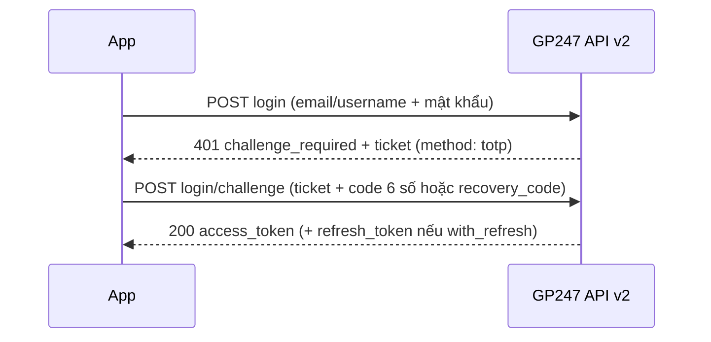

> 🌐 **Ngôn ngữ:** 🇻🇳 Tiếng Việt (hiện tại) · [🇬🇧 English](./readme.md) · [🇯🇵 日本語](./readme_ja.md)

# Plugin MFA (Multi-Factor Authentication) cho GP247

## Tổng quan

Plugin MFA cung cấp xác thực 2 lớp (Two-Factor Authentication) cho hệ thống GP247, tăng cường bảo mật tài khoản người dùng. Plugin hỗ trợ đa guards (customer, admin, vendor, pmo...) cho phép linh hoạt trong việc quản lý xác thực người dùng.

## Minh họa giao diện

<p align="center">
  
  
  
</p>


## Tính năng

- ✅ Xác thực 2 lớp sử dụng TOTP (Time-based One-Time Password)
- ✅ Hỗ trợ nhiều guards: customer, admin, vendor, pmo
- ✅ Mã QR dễ dàng quét bằng ứng dụng xác thực
- ✅ Mã khôi phục (Recovery Codes) khi mất thiết bị
- ✅ Quản lý MFA từ Admin panel
- ✅ Thống kê tỷ lệ sử dụng MFA theo guard
- ✅ Có thể bắt buộc MFA cho từng guard
- ✅ Áp cả cho đăng nhập REST API v2 của khách và quản trị (từ 2.3.0, cần gp247/core 3.6)
- ✅ Giao diện thân thiện và responsive
- ✅ Đa ngôn ngữ (Tiếng Việt, Tiếng Anh)

## Yêu cầu hệ thống

- GP247 Core >= 1.2
- Laravel 12.x
- PHP >= 8.2
- Các packages:
  - pragmarx/google2fa: ^8.0 hoặc ^9.0
  - bacon/bacon-qr-code: ^2.0 hoặc ^3.0

## Cài đặt

### Bước 1: Cài đặt các package phụ thuộc

Thêm các packages vào `composer.json` của project:

```bash
composer require pragmarx/google2fa
composer require bacon/bacon-qr-code
```

**Lưu ý**: Chạy lệnh này ở thư mục gốc của project GP247, không phải trong thư mục plugin.

### Bước 2: Cài đặt plugin

Có 4 phương pháp cài đặt plugin:

#### Phương pháp 1: Cài đặt từ thư viện trực tuyến

1. Truy cập "Extensions" trong admin dashboard
2. Chọn "Plugins"
3. Chọn tab "Install from Library"
4. Tìm plugin "MFA" và click "Install"
5. Click "Enable" để kích hoạt plugin

#### Phương pháp 2: Import file zip

1. Truy cập Admin Panel > Extensions > Plugins
2. Chọn tab "Import file"
3. Chọn file zip của plugin MFA
4. Hoàn tất quá trình import
5. Click "Enable" để kích hoạt plugin

#### Phương pháp 3: Cài đặt thủ công

Trong trường hợp gặp khó khăn khi import file zip (lỗi upload, vấn đề về file tạm thời, v.v.):

1. Giải nén và copy thư mục source code vào thư mục tương ứng:
   ```
   app/GP247/Plugins/MFA
   ```

2. Copy thư mục `MFA/public` vào đường dẫn public tương ứng:
   ```
   public/GP247/Plugins/MFA
   ```

3. Truy cập Admin Panel > Extensions > Plugins
4. Trong tab "Local storage" mặc định, tìm "MFA" và click "Install"
5. Click "Enable" để kích hoạt plugin

#### Phương pháp 4: Cài bằng dòng lệnh (CLI, gp247 3.x)

Từ gp247 3.x, bạn có thể tải **MFA** từ thư viện GP247 và cài ngay bằng dòng lệnh mà không cần mở admin. **Bắt buộc làm Bước 1 trước** (`composer require pragmarx/google2fa bacon/bacon-qr-code`), nếu không lệnh sẽ dừng vì thiếu gói. Mở Terminal tại thư mục gốc website rồi chạy:

```bash
# 1) Chỉ làm 1 lần cho mỗi website: đăng ký API License (miễn phí) để kết nối thư viện GP247
php artisan gp247:ext-register-license

# 2) Tải plugin từ thư viện và cài
php artisan gp247:ext-install --type=plugin --key=MFA
```

- Trước bước 1, kiểm tra `APP_URL` trong `.env` là **domain thật** của website (không để `http://localhost`), vì license được gắn với domain này.
- Cài xong, plugin được **bật sẵn** và cache tự làm mới, bạn không cần nhấn Install/Enable trong admin nữa.
- Lệnh tự kiểm tra điều kiện khai báo trong `gp247.json` (phiên bản core, gói composer, plugin phụ thuộc). Nếu thiếu, lệnh dừng lại và báo rõ thiếu gì (ví dụ chưa cài `pragmarx/google2fa` hoặc `bacon/bacon-qr-code`).
- Nếu thư mục `app/GP247/Plugins/MFA` đã có sẵn trên máy (chép thủ công hoặc có sẵn theo bộ cài), lệnh sẽ **cài tại chỗ**, không tải lại.
- Nếu plugin đã được cài, lệnh sẽ từ chối. Để lên bản mới, chạy `php artisan gp247:ext-update --type=plugin --key=MFA`.
- Thêm `--json` vào cuối lệnh để nhận kết quả dạng máy đọc được (dùng cho script/CI).
- Các bước cấu hình sau khi cài bên dưới (**Bước 3**) vẫn giữ nguyên.
- Chi tiết: [Hướng dẫn cài đặt Plugin & Template](https://github.com/gp247net/gp247-docs/blob/main/extension/install-extension_vi.md) · [Tra cứu lệnh](https://github.com/gp247net/gp247-docs/blob/main/system/command-line-reference_vi.md).

**Tham khảo**: [Hướng dẫn cài đặt Extension](https://gp247.net/vi/docs/user-guide-extension/guide-to-installing-the-extension.html)

### Bước 3: Cấu hình

Sau khi cài đặt thành công, plugin MFA sẽ xuất hiện trong menu:
**Admin Panel > Cấu hình hệ thống > Bảo mật > MFA**

#### Cấu hình qua file config

Để cấu hình plugin, chỉnh sửa file: `app/GP247/Plugins/MFA/config.php`

**Mặc định**: Plugin chỉ được kích hoạt cho guard **admin**.

Các tham số cấu hình cho mỗi guard:

- **enabled**: `1` = bật, `0` = tắt MFA cho guard
- **forced**: `1` = bắt buộc, `0` = tùy chọn (người dùng có thể bật/tắt MFA)
- **model**: Model class của user
- **qr_code_size**: Kích thước mã QR (100-500px)
- **recovery_codes_count**: Số lượng mã khôi phục (4-20)
- **window**: Cửa sổ thời gian cho phép (0-5, khuyến nghị 1)

Ví dụ cấu hình:

```php
'guards' => [
    'customer' => [
        'enabled' => 0,  // Tắt MFA cho customer
        'forced' => 0,
        // ... các tham số khác
    ],
    'admin' => [
        'enabled' => 1,  // Bật MFA cho admin (mặc định)
        'forced' => 0,   // Không bắt buộc
        // ... các tham số khác
    ],
],
```

**Lưu ý**: Sau khi chỉnh sửa file config, cần clear cache:
```bash
php artisan config:clear
php artisan cache:clear
```

## Sử dụng

### Cho người dùng cuối

#### Thiết lập MFA

1. Truy cập trang quản lý MFA: `/mfa/setup/customer`
2. Quét mã QR bằng ứng dụng xác thực (Google Authenticator, Authy, Microsoft Authenticator, v.v.)
3. Nhập mã 6 chữ số từ ứng dụng để xác minh
4. Lưu các mã khôi phục ở nơi an toàn

#### Đăng nhập với MFA

1. Đăng nhập bằng username/password như bình thường
2. Sau khi đăng nhập thành công, hệ thống sẽ yêu cầu mã MFA
3. Nhập mã 6 chữ số từ ứng dụng xác thực
4. Hoặc sử dụng mã khôi phục 8 ký tự nếu mất thiết bị

#### Quản lý MFA

- Xem trạng thái MFA: `/mfa/manage/customer`
- Xem mã khôi phục: `/mfa/recovery-codes/customer`
- Tạo lại mã khôi phục: Từ trang quản lý MFA
- Tắt MFA: Từ trang quản lý MFA (yêu cầu xác nhận mật khẩu)

### Cho Admin

#### Xem thống kê

- Truy cập Admin Panel > Extensions > MFA
- Xem tỷ lệ người dùng đã bật MFA theo từng guard
- Xem tổng số người dùng và số người đã bật MFA

#### Cấu hình guards

- Bật/tắt MFA cho từng guard
- Bắt buộc người dùng phải bật MFA
- Điều chỉnh các thông số kỹ thuật

#### Reset MFA cho người dùng

- Từ trang quản lý MFA, Admin có thể reset MFA cho bất kỳ người dùng nào
- Người dùng sẽ phải thiết lập MFA lại từ đầu

## Luồng Xử Lý MFA

### 1. Luồng Setup MFA (Lần Đầu)

```
┌─────────────────────────────────────────────────────────────┐
│                    User Login Success                        │
└────────────────────────┬────────────────────────────────────┘
                         │
                         ▼
                ┌────────────────────┐
                │  MFA Enabled cho   │
                │  guard này?        │
                └────────┬───────────┘
                         │
        ┌────────────────┴────────────────┐
        │ No                               │ Yes
        ▼                                  ▼
┌───────────────┐              ┌────────────────────┐
│  Allow Access │              │ User đã enroll MFA?│
└───────────────┘              └─────────┬──────────┘
                                         │
                        ┌────────────────┴────────────────┐
                        │ No                               │ Yes
                        ▼                                  ▼
              ┌──────────────────┐              ┌──────────────────┐
              │  MFA Forced?     │              │ Session verified?│
              └────────┬─────────┘              └────────┬─────────┘
                       │                                 │
         ┌─────────────┴──────────┐           ┌─────────┴─────────┐
         │ No          │ Yes      │           │ No     │ Yes      │
         ▼             ▼          │           ▼        ▼          │
    Allow Access   Redirect      │      Redirect  Allow Access   │
                   to Setup      │      to Verify                │
                       │          │           │                   │
                       ▼          │           ▼                   │
              ┌─────────────┐    │   ┌─────────────────┐        │
              │ Show QR Code│    │   │ Enter 6-digit   │        │
              │ & Secret    │    │   │ code or         │        │
              └──────┬──────┘    │   │ recovery code   │        │
                     │           │   └────────┬────────┘        │
                     ▼           │            │                  │
              ┌─────────────┐    │            ▼                  │
              │ Verify Code │    │   ┌─────────────────┐        │
              └──────┬──────┘    │   │  Code Valid?    │        │
                     │           │   └────────┬────────┘        │
                     ▼           │            │                  │
            ┌─────────────────┐ │   ┌────────┴────────┐        │
            │ Generate        │ │   │ No    │ Yes     │        │
            │ Recovery Codes  │ │   ▼       ▼         │        │
            └────────┬────────┘ │  Error  Set         │        │
                     │          │         Session     │        │
                     ▼          │         Verified    │        │
            ┌─────────────────┐ │            │        │        │
            │ Show & Save     │ │            ▼        │        │
            │ Recovery Codes  │ │    ┌──────────────┐ │        │
            └────────┬────────┘ │    │Allow Access  │ │        │
                     │          │    └──────────────┘ │        │
                     ▼          │                      │        │
            ┌─────────────────┐ │                      │        │
            │ MFA Activated   │ │                      │        │
            └────────┬────────┘ │                      │        │
                     │          │                      │        │
                     └──────────┴──────────────────────┘        │
                                │                               │
                                └───────────────────────────────┘
```

### 2. Luồng Login với MFA (Đã Setup)

```
┌─────────────────────┐
│ User Login          │
│ (Email + Password)  │
└──────────┬──────────┘
           │
           ▼
┌──────────────────────┐
│ Credentials Valid?   │
└──────────┬───────────┘
           │
    ┌──────┴──────┐
    │ No   │ Yes  │
    ▼      ▼      │
  Error  Check    │
         MFA      │
           │      │
           ▼      │
┌─────────────────────┐
│ User enrolled MFA?  │
└──────────┬──────────┘
           │
    ┌──────┴──────┐
    │ No   │ Yes  │
    ▼      ▼      │
  Allow  Redirect │
  Access to MFA   │
         Verify   │
           │      │
           ▼      │
┌────────────────────────────┐
│ MFA Verification Page      │
│                            │
│ [Enter 6-digit code]       │
│ or                         │
│ [Use recovery code]        │
└──────────┬─────────────────┘
           │
           ▼
┌──────────────────────┐
│ Verify Code          │
│ (TOTP or Recovery)   │
└──────────┬───────────┘
           │
    ┌──────┴──────────┐
    │ Valid │ Invalid │
    ▼       ▼         │
┌─────────────┐  ┌─────────┐
│ Set Session │  │ Show    │
│ Verified    │  │ Error   │
└──────┬──────┘  └────┬────┘
       │              │
       ▼              ▼
┌──────────────┐  ┌──────────┐
│ Allow Access │  │ Try Again│
└──────────────┘  └──────────┘
```

### 3. Luồng Sử Dụng Recovery Code

```
┌──────────────────────┐
│ User mất điện thoại  │
└──────────┬───────────┘
           │
           ▼
┌──────────────────────┐
│ Login Page           │
│ Enter credentials    │
└──────────┬───────────┘
           │
           ▼
┌──────────────────────────┐
│ MFA Verification Page    │
│                          │
│ Click "Use recovery code"│
└──────────┬───────────────┘
           │
           ▼
┌──────────────────────────┐
│ Enter 8-char recovery    │
│ code (e.g. ABCD1234)     │
└──────────┬───────────────┘
           │
           ▼
┌──────────────────────┐
│ Check recovery code  │
│ in database          │
└──────────┬───────────┘
           │
    ┌──────┴───────┐
    │ Valid│Invalid│
    ▼      ▼       │
┌────────────┐ ┌────────┐
│ Mark code  │ │ Error  │
│ as used    │ └────────┘
└─────┬──────┘     │
      │            │
      ▼            │
┌────────────┐     │
│ Login OK   │     │
└─────┬──────┘     │
      │            │
      ▼            │
┌──────────────────┐
│ Redirect to      │
│ MFA Setup        │
│ (Setup new device)│
└──────────────────┘
```

### 4. Middleware Flow

```
┌──────────────────────────┐
│ Request to protected     │
│ route with mfa.verify    │
└───────────┬──────────────┘
            │
            ▼
┌───────────────────────────┐
│ Middleware: Check Auth    │
└───────────┬───────────────┘
            │
     ┌──────┴──────┐
     │ Not  │ Auth │
     │ Auth │      │
     ▼      ▼      │
   Redirect Check  │
   to Login MFA    │
            │      │
            ▼      │
┌─────────────────────────┐
│ MFA enabled for guard?  │
└───────────┬─────────────┘
            │
     ┌──────┴──────┐
     │ No   │ Yes  │
     ▼      ▼      │
   Allow  Check    │
   Access Session  │
            │      │
            ▼      │
┌──────────────────────────┐
│ Session verified?        │
└───────────┬──────────────┘
            │
     ┌──────┴──────┐
     │ Yes  │ No   │
     ▼      ▼      │
   Allow  Check    │
   Access User     │
          MFA      │
            │      │
            ▼      │
┌──────────────────────────┐
│ User enrolled MFA?       │
└───────────┬──────────────┘
            │
     ┌──────┴──────┐
     │ No   │ Yes  │
     ▼      ▼      │
   Check  Redirect │
   Forced to MFA   │
   MFA    Verify   │
     │             │
     ▼             │
┌──────────────┐   │
│ MFA Forced?  │   │
└──────┬───────┘   │
       │           │
  ┌────┴────┐      │
  │No  │Yes │      │
  ▼    ▼    │      │
Allow Redirect     │
Access to Setup    │
       │           │
       └───────────┘
```

## MFA cho ứng dụng dùng REST API (v2)

> ℹ️ **Có từ:** MFA 2.3.0 · cần gp247/core 3.6.0 (gp247/shop 3.4.0 cho API khách)

Khi plugin đang bật, người dùng **đã kích hoạt MFA** (guard `customer` hoặc `admin` đang bật) cũng phải nhập mã khi đăng nhập
qua REST API v2 — app di động hay app quản trị không còn là đường vòng né MFA. Plugin tự đăng ký với core, không cần cấu hình thêm.



| Trường gửi lên `login/challenge` | Ý nghĩa |
| --- | --- |
| `ticket` | Vé nhận được ở bước `login` (dùng một lần, hết hạn sau 5 phút) |
| `code` | Mã 6 số trong ứng dụng xác thực |
| `recovery_code` | Thay cho `code` khi mất thiết bị: một mã khôi phục 8 ký tự (dùng xong là mất) |

- Một mã 6 số đã dùng thành công qua API **không dùng lại được** trong khung thời gian của nó.
- Guard đặt **bắt buộc MFA** mà tài khoản **chưa kích hoạt**: API trả `challenge_required` với `method: "setup_required"` và
  không thể hoàn tất — người dùng vào website bật MFA trước, sau đó đăng nhập app như trên.
- Tài khoản không bật MFA, hoặc guard đang tắt: đăng nhập API như bình thường.
- API v1 không có bước nhập mã: tài khoản đã bật MFA đăng nhập v1 nhận `401 challenge_required` — hãy dùng v2.
- Site chạy gp247/core cũ hơn 3.6: plugin vẫn bảo vệ đăng nhập website như trước, chưa áp cho API.

Chi tiết phía API: [Giới thiệu API GP247 — mục 10.4](https://github.com/gp247net/gp247-docs/blob/main/api/api-introduction_vi.md).

## Tích hợp vào code

### Middleware

Sử dụng middleware `mfa.verify` để bảo vệ các routes:

```php
// Trong routes/web.php
Route::group(['middleware' => ['auth:customer', 'mfa.verify:customer']], function () {
    Route::get('/dashboard', 'DashboardController@index');
    Route::get('/profile', 'ProfileController@index');
});

// Cho admin
Route::group(['middleware' => ['auth:admin', 'mfa.verify:admin']], function () {
    Route::get('/admin/dashboard', 'AdminController@index');
});
```

### Helper functions

```php
// Kiểm tra MFA có được bật cho guard không
if (mfa_is_enabled_for_guard('customer')) {
    // MFA is enabled
}

// Kiểm tra user đã đăng ký MFA chưa
if (mfa_is_user_enrolled($user, 'customer')) {
    // User has enrolled MFA
}

// Kiểm tra session đã verify MFA chưa
if (mfa_is_verified()) {
    // Session is verified
}

// Đánh dấu session đã verify
mfa_set_verified();

// Xóa verify khỏi session
mfa_clear_verified();

// Tạo link đến các trang MFA
route('mfa.setup.show', 'customer')        // /mfa/setup/customer
route('mfa.manage', 'customer')            // /mfa/manage/customer
route('mfa.recovery_codes', 'customer')    // /mfa/recovery-codes/customer
route('mfa.verify.show', 'customer')       // /mfa/verify/customer
```

## Cấu trúc thư mục

```
app/GP247/Plugins/MFA/
├── Admin/
│   └── AdminController.php          # Controller cho admin panel
├── Controllers/
│   └── MFAController.php            # Controller chính cho MFA
├── Helpers/
│   └── TwoFactorHelper.php          # Helper cho Google 2FA
├── Lang/
│   ├── en/
│   │   └── lang.php                 # Ngôn ngữ tiếng Anh
│   └── vi/
│       └── lang.php                 # Ngôn ngữ tiếng Việt
├── Middleware/
│   └── TwoFactorAuthentication.php # Middleware xác thực MFA
├── Models/
│   ├── ExtensionModel.php           # Model cài đặt/gỡ bỏ
│   └── TwoFactorAuth.php            # Model lưu trữ MFA
├── Views/
│   ├── Admin.blade.php              # View admin
│   └── Frontend/
│       ├── setup.blade.php          # View thiết lập MFA
│       ├── verify.blade.php         # View xác thực MFA
│       ├── recovery_codes.blade.php # View mã khôi phục
│       └── manage.blade.php         # View quản lý MFA
├── AppConfig.php                     # Cấu hình plugin
├── config.php                        # File cấu hình
├── function.php                      # Helper functions
├── gp247.json                        # Metadata plugin
├── Provider.php                      # Service provider
├── Route.php                         # Routes
└── readme_vi.md                      # Tài liệu này
```

## Bảo mật

### Mã hóa

- Secret key được mã hóa trong database sử dụng Laravel Encryption
- Recovery codes được mã hóa trong database
- Tất cả dữ liệu nhạy cảm đều được bảo vệ

### Best Practices

1. **Bắt buộc MFA cho Admin**: Nên bật "Forced" cho guard admin
2. **Giáo dục người dùng**: Hướng dẫn người dùng lưu mã khôi phục an toàn
3. **Kiểm tra định kỳ**: Theo dõi tỷ lệ sử dụng MFA
4. **Backup**: Đảm bảo database được backup thường xuyên
5. **HTTPS**: Bắt buộc sử dụng HTTPS cho tất cả các trang MFA

## Ứng dụng xác thực được hỗ trợ

Plugin hỗ trợ tất cả các ứng dụng xác thực TOTP:

- Google Authenticator (iOS, Android)
- Microsoft Authenticator (iOS, Android)
- Authy (iOS, Android, Desktop)
- 1Password (iOS, Android, Desktop)
- LastPass Authenticator
- Duo Mobile
- FreeOTP
- Và nhiều ứng dụng TOTP khác

## Xử lý sự cố

### Người dùng mất thiết bị xác thực

1. Người dùng sử dụng mã khôi phục để đăng nhập
2. Sau khi đăng nhập, thiết lập MFA lại với thiết bị mới
3. Lưu mã khôi phục mới

### Mã xác thực không hoạt động

1. Kiểm tra thời gian trên thiết bị có chính xác không
2. Tăng giá trị "Window" trong cấu hình (khuyến nghị 1-2)
3. Đảm bảo đã quét đúng mã QR

### Admin muốn reset MFA cho người dùng

1. Truy cập Admin Panel > Extensions > MFA
2. Tìm người dùng trong danh sách
3. Click "Reset MFA"
4. Người dùng sẽ phải thiết lập MFA lại

## Hỗ trợ

- Website: https://GP247.net
- Email: support@gp247.net
- Documentation: https://gp247.net/vi/product/plugin-mfa.html

## Giấy phép

MIT License

## Tác giả

GP247 Team

## Changelog

### Version 2.3.0
- MFA cho đăng nhập REST API v2 (khách + quản trị) qua bước `login/challenge` của gp247/core 3.6: mã TOTP hoặc mã khôi phục, chống dùng lại mã, guard bắt buộc chặn API khi chưa kích hoạt

### Version 1.0
- Initial release
- Support for Customer, Admin, Vendor, PMO guards
- TOTP authentication with Google Authenticator
- Recovery codes system
- Admin management panel
- Multi-language support (Vietnamese, English)

